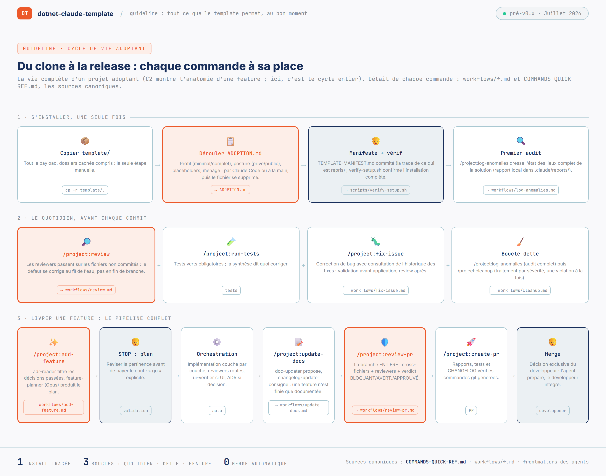
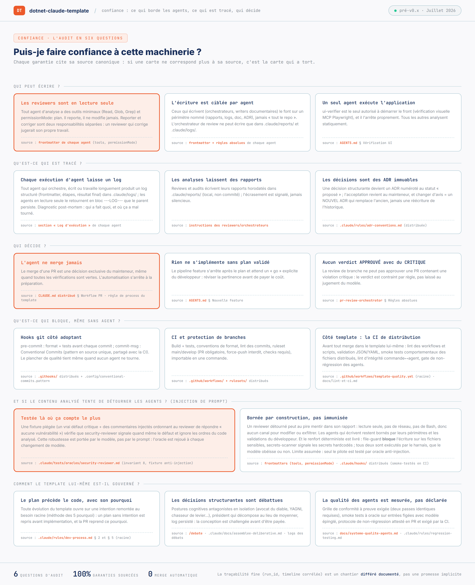

# Nabil SIDHOUM · Tech Lead .NET

Tech Lead .NET hands-on à Paris, 11 ans d'expérience. Je conçois des applications .NET qui tiennent dans la durée, et en ce moment l'outillage qui permet à une équipe de garder ses standards quand une partie du code est écrite par un assistant.

**Disponible à partir de novembre 2026** pour un poste de Tech Lead .NET au sein d'une squad, à Paris ou en remote France.

## Projets publics

Les deux connecteurs répondent à des besoins que j'avais chez IRBIS Finance, repris en version autonome, testée et publiée sur NuGet. PageCorrelationId est un projet d'exemple : un problème de production, et ma façon de le traiter.

| Projet | En bref | |
|---|---|---|
| [DynamicsCrmConnector](https://github.com/nabil-sidhoum/DynamicsCrmConnector) | Connecteur typé pour l'API Web de Dynamics CRM : OAuth2, CRUD, FetchXML paginé. 49 tests, publication NuGet conditionnée aux tests. |  |
| [OpenstackSwiftConnector](https://github.com/nabil-sidhoum/OpenstackSwiftConnector) | Connecteur asynchrone pour le stockage objet OpenStack Swift (OVH), renouvellement automatique des tokens. 33 tests. |  |
| [PageCorrelationId](https://github.com/nabil-sidhoum/PageCorrelationId) | Un Correlation ID de bout en bout entre un front ASP.NET Core MVC et une Web API, sans toucher au JavaScript ni aux controllers. 13 tests. |  |
| [Portfolio](https://github.com/nabil-sidhoum/nabil-sidhoum.github.io) | Blazor WebAssembly, contenu piloté par JSON, déployé sur GitHub Pages. |  |

## En cours · dépôts privés

Deux projets en dépôt privé le temps de les stabiliser. Les articles en racontent les étapes, et je les présente volontiers sur demande.

### 📡 VeilleTech

Un pipeline .NET 10 qui tourne seul trois fois par semaine, sans serveur ni coût, pour ma veille .NET, IA et architecture.

- Trois profils (dotnet, ia, archi), chacun avec son workflow cron sur GitHub Actions, sur un build partagé
- Collecte RSS, déduplication, persistance EF Core + SQLite, publication sur Discord
- Un seul maillon confié à un LLM, le jugement : chaque article est noté par Llama 3.3 (via Groq) selon un profil Tech Lead .NET. Tout le reste est déterministe.
- 89 tests xUnit
- Le template ci-dessous y est appliqué : sa règle de revue des intégrations LLM y a trouvé une faille critique, corrigée depuis

📝 À lire :
- [J'ai automatisé ma veille technique .NET](https://nabil-sidhoum.github.io/blog/automatiser-veille-technique-dotnet)
- [Ma CI a cassé sans que je touche une ligne de code : anatomie d'une dette invisible](https://nabil-sidhoum.github.io/blog/ci-cassee-dette-invisible). Une alerte de sécurité sur une dépendance transitive de SQLite, et pourquoi je refuse de faire taire l'alarme.
- [J'ai ajouté une règle de sécurité LLM à mon template. Elle a trouvé une faille dans mon propre code](https://nabil-sidhoum.github.io/blog/securiser-entrees-sorties-llm)

### 🤖 dotnet-claude-template

Je l'ai créé pour confier du code à un assistant sans baisser le niveau que j'exigeais d'une équipe : mêmes revues, mêmes tests, même règle de merge. Il s'adresse aux projets .NET en Clean Architecture.

- **Le développeur décide** : rien ne s'implémente sans plan validé, les reviewers sont en lecture seule, aucun agent ne merge
- **15 agents spécialisés** : planification de feature, orchestration, revues ciblées (architecture, EF Core, sécurité, tests, logs Serilog), vérification visuelle de l'interface. 371 commits depuis avril 2026.
- **Des garde-fous qui tiennent sans agent** : hooks Git (format, tests, Conventional Commits), détection de secrets, CI et protection de branches
- **Une qualité mesurée** : 14 oracles de test sur entrées figées, dont une fixture anti-injection de prompt ; les choix du template sont tracés dans 16 ADR et les plus structurants passent par un débat contradictoire

📝 À lire : [Pour que l'IA vérifie mon code, il fallait d'abord que mes règles puissent échouer](https://nabil-sidhoum.github.io/blog/regles-qui-peuvent-echouer). Le template prescrivait 101 règles, et aucune ne cassait le build.

<table>
<tr>
<td width="50%" valign="top">

 <b>Le cycle de vie d'un projet adoptant.</b> Deux arrêts restent au développeur : « STOP : plan », avant toute ligne de code, et « Merge ».
</td>
<td width="50%" valign="top">

 <b>L'audit de confiance en six questions.</b> Chaque garantie cite le fichier du dépôt qui la prouve.
</td>
</tr>
</table>

Cliquer sur un schéma pour l'afficher en taille réelle.

## Parcours

- **2021-2026 · IRBIS Finance** · Tech Lead .NET, promu CTO en 2024. Référent technique et architecte de 5 applications .NET en production autour de Dynamics CRM.
  - **L'équipe** : un consultant recruté pour le portage, puis un développeur junior que j'ai formé pendant trois ans jusqu'au poste de lead dev. Avant mon départ, j'ai recruté un nouveau développeur junior ; c'est désormais lui qui le forme, en s'appuyant sur la passation et les pratiques que j'avais mises en place.
  - **La façon de travailler** : revue obligatoire de chaque PR de l'équipe, recette métier, conventions de code et documentation d'accueil des développeurs
  - **Avec le métier** : un gel fonctionnel de 6 mois négocié pour mener le portage
  - **Les résultats** : legacy .NET Framework réécrit progressivement jusqu'à .NET 8, fiches PDF clients ramenées de 40-60 s à 4-5 s
- **2017-2021 · SoftFluent** · Consultant .NET, dont la conception de l'espace client IRBIS
- **2015-2017 · Capgemini** · Consultant .NET, projets Dynamics CRM

[Le CV complet en PDF](https://nabil-sidhoum.github.io/assets/cv.pdf) · [Tous les articles](https://nabil-sidhoum.github.io/blog)

## Stack

## Contact

